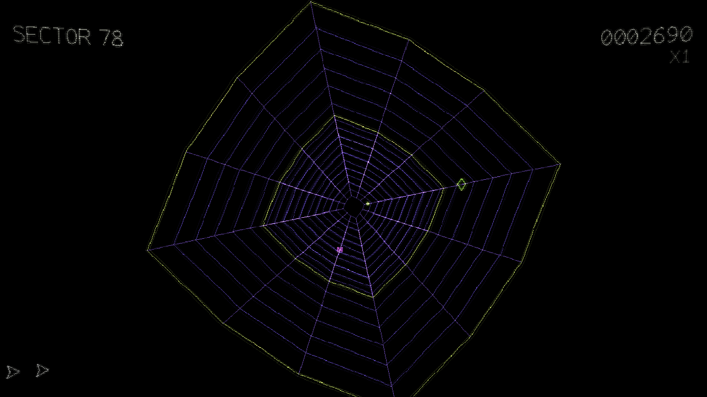

# NEURO-VECTOR

A multiplatform (Windows / Linux / macOS) C++17 + SDL2 arcade game: a deterministic,
seed-driven **vector tunnel shooter** recreating the *Polybius* urban-legend experience —
glowing wireframe graphics, procedural synth music and SFX, CRT artefacts, and the cabinet
mystique. 100% original code, art and audio.



## Features
- **100 playable levels, all procedural, all deterministic** — every sector is generated
  from `hash(BASE_SEED, level, loop)` with a Mersenne Twister, so layouts are reproducible
  bit-for-bit (pinned by `tests/golden/level_hashes.txt`).
- **Three tiers:** L1–33 Tunnel Geometry (regular polygons, lanes 6→9), L34–66 Warped &
  Open Planes (superellipse / lemniscate / infinity rims, lanes 10→12), L67–100
  Hyper-Dimensional (nested inner/outer tracks + ring jump, camera roll, lanes 12→16).
  After sector 100: victory → endless loop with +15% speed.
- **6 enemy archetypes:** SEEKER, FLIPPER, SPLITTER (+shards), PULSAR (electrifies lanes),
  MIRROR (inverts your controls), WEAVER (spirals, invulnerable while warping).
- **Quadrascan-style vector rendering** — everything is glowing wireframes (stroke font
  included, zero textures/sprites), phosphor glow, CRT pass: barrel-warp mesh, scanlines,
  vignette, chromatic aberration, additive bloom, phosphor-persistence burn-in.
- **Fully procedural audio** — raw `SDL_OpenAudioDevice` callback synthesis: oscillator
  bank + ADSR + state-variable filters, a 16-step minor-key step sequencer per sector
  (kick / offbeat hats / seeded arps / i–VI–III–VII progression), sub-bass drone mapped to
  threat level, sample-accurate beat clock driving the tunnel pulse.
- **The myth layer (safety-first):** a **single main screen** — title, photosensitivity
  **warning lines** and the full options menu together (START GAME / SAFE MODE / CRT FX /
  HOW TO PLAY / DIAGNOSTICS, no extra screens before playing), persistent **Safe Mode**
  (caps strobes < 3 Hz via FlashGuard, disables the subliminal layer, shortens trails),
  1–2-frame subliminal flashes (`FORGET`, `OBEY`, `SENSE-WIPE`) every 45–90 s in normal mode.
- **Cabinet mystique:** attract mode with AI demo play + "INSERT COIN" carousel, top-5
  high scores with 3-letter arcade initials, a **HOW TO PLAY** screen (H) with the mission,
  controls, enemy bestiary and scoring, and the hidden operator menu —
  `NEURO-VECTOR DIAGNOSTICS v1.4` (press **F1** or pick DIAGNOSTICS).

## Build
```sh
./build.sh          # configure + build (Release)
./build.sh run      # build, then launch the game
./build.sh test     # build, then run the headless selftest (incl. menu regression)
./build.sh debug    # Debug build
./build.sh clean    # remove the build directory
./build/neuro-vector --menutest   # menu regression test only
```
By default CMake fetches and builds **SDL 2.30.8** automatically (deterministic on all
three OSes — no system install needed). To use a system SDL2 instead:
```sh
cmake -B build -DNEURO_USE_SYSTEM_SDL=ON
```

## Controls
| Action | Keys | Gamepad |
|---|---|---|
| Rotate / dial | ← → or A D, mouse-X | Left stick / d-pad |
| Fire | Space or left-click (hold) | A |
| Super (smart bomb) | Shift | B |
| Ring jump (hyper sectors 67+) | E | Y |
| Start / coin | Enter or C | Start |
| Menu navigate | ↑ ↓ (or W/S) | D-pad up/down |
| Menu select | Enter / Space | A / Start |
| Pause | Esc | Start |
| Operator menu | F1 | Back |
| Help (how to play) | H, or title menu | — |
| Fullscreen | F11 | — |

Operator menu (`F1` or DIAGNOSTICS row): up/down + `ENTER` on Safe Mode, CRT FX, mouse dial,
master volume, reset scores; `ESC`/`F1` back. Menu keys auto-repeat when held.

## Scoring
Kill = base × multiplier × proximity bonus (near-rim kills worth up to 3×). The
multiplier chain grows per kill (×1→×64) and resets when you take a hit. Extra lives at
20k / 50k / 120k, super charges at 30k / 80k / 150k.

## Headless tooling
```sh
./build/neuro-vector --selftest              # determinism + strobe-safety checks
./build/neuro-vector --selftest --dump-golden  # regenerate the golden hash pins
./build/neuro-vector --shot out.bmp --level 77 --frames 300 [--safe]  # capture a sector
```

## Project layout
```
src/
├─ core/        Game (states + loop), Config (settings/scores), Input, Common, Rng
├─ renderer/    VecFont (stroke font), LineRenderer (phosphor glow), CrtPass
├─ game/        World (sim), RenderWorld (projection + wireframes), Types
├─ levels/      LevelGen — the deterministic 100-sector universe
├─ audio/       AudioEngine (SDL callback), Synth voices, Sequencer
├─ fx/          Subliminal, aberration, shake, FlashGuard / Safe Mode
└─ meta/        OperatorMenu (NEURO-VEKTOR DIAGNOSTIK)
tests/golden/   level layout hash pins
```

## Notes
- Logic runs at a fixed 60 Hz with render interpolation — strobe timing and beat sync are
  frame-rate independent.
- All randomness in the simulation comes from seeded level streams; `tests/golden/` fails
  CI on any generation drift.
- Neuro-Vector is an original work inspired by folklore. It is not affiliated with any
  existing "Polybius" game.
